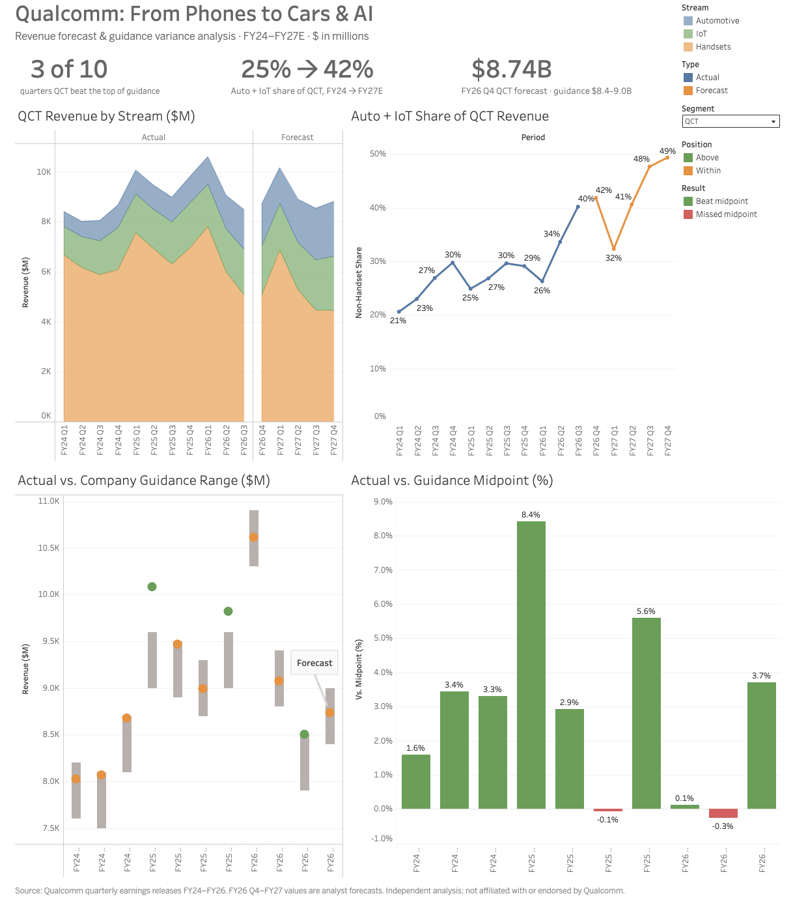

# Qualcomm Financial Revenue Forecast & Earnings Variance Analysis
*Forecasting Qualcomm's shift from phones to cars & AI*

**[View the interactive dashboard on Tableau Public](https://public.tableau.com/app/profile/calvin.magsie/viz/QualcommFinancialRevenueForecastandEarningsVarianceAnalysis/Dashboard)**

An FP&A-style analysis of Qualcomm (NASDAQ: QCOM) built entirely from public earnings releases: guidance-vs-actual variance, a driver-based rolling forecast, and base/bull/bear scenarios.

**Core question:** Can QCT Automotive and IoT growth offset the decline in Handsets through FY27?

## Key Findings
- **Conservative guidance:** QCT revenue landed at or above the guidance range in all 10 quarters (3 above, 7 within), finishing on average 92% of the way to the top of the range.
- **Mix shift:** Automotive + IoT grew from 25% of QCT revenue (FY24) to a forecast 42% (FY27E).
- **Not yet offsetting:** In the base case, Auto + IoT gains replace about 62% (FY26E) and 84% (FY27E) of lost handset revenue. Only the bull case fully offsets it.
- **FY26 Q4 forecast (locked pre-earnings):** QCT $8.74B vs. company guidance of $8.4–9.0B.

**Full write-up:** [Recommendation memo](docs/memo.md)

## FY26 Q4 Pre-Earnings Forecast
| Scenario | QCT revenue | QTL revenue | Company guidance (QCT / QTL) |
|---|---|---|---|
| Base | $8.74B | $1.30B | $8.4B–$9.0B / $1.2B–$1.4B |
| Bull | $9.19B | $1.40B | |
| Bear | $8.21B | $1.21B | |

Locked before the earnings release via git tag `fy26q4-forecast-lock`. Actual-vs-forecast variance will be added after Qualcomm reports.

## Method
- **Driver-based forecast:** each revenue stream (Handsets, Automotive, IoT, QTL licensing) is forecast as *same quarter prior year × (1 + YoY growth)*, which preserves Qualcomm's seasonality. EBT = revenue × margin assumption.
- **Drivers** are anchored to company guidance and management commentary, and documented with a rationale in the Assumptions tab.
- **Scenarios:** base/bull/bear selector, plus a FY27 sensitivity table (handset growth × automotive growth).
- **Why not a statistical model?** 11 quarters is too short a history for a reliable time-series model, and the business is going through structural change (Apple modem roll-off, automotive ramp).

## Repository Layout
~~~
qualcomm-revenue-forecast/
├── data/
│   ├── raw/              # Earnings release PDFs and SEC Excel filings
│   └── processed/        # segment_actuals.csv, guidance.csv
├── model/                # Excel forecast & variance model
├── forecasts/            # Locked pre-earnings forecast snapshots
├── docs/                 # Source log, assumptions log
├── scripts/              # Download, validation, model build, forecast lock
└── images/               # Dashboard screenshot
~~~

## Excel Model Tabs
Assumptions · Actuals · Guidance · Variance · Forecast · Summary · Scenarios · Sensitivity · Checks · Tableau exports

## Reproduce
~~~bash
python3 -m venv .venv && source .venv/bin/activate
pip install pandas openpyxl requests
python scripts/validate_data.py     # data integrity checks
python scripts/build_model.py       # rebuilds model/qcom_revenue_forecast_model.xlsx
python scripts/lock_forecast.py     # snapshots the current forecast
~~~

## Data Sources
Qualcomm quarterly earnings releases, FY24 Q1–FY26 Q3 (full log in `docs/sources.csv`).

## Disclaimer
This is an independent portfolio project built solely from public information. It is not affiliated with or endorsed by Qualcomm. Forecast drivers are analyst assumptions, and nothing here is investment advice.
